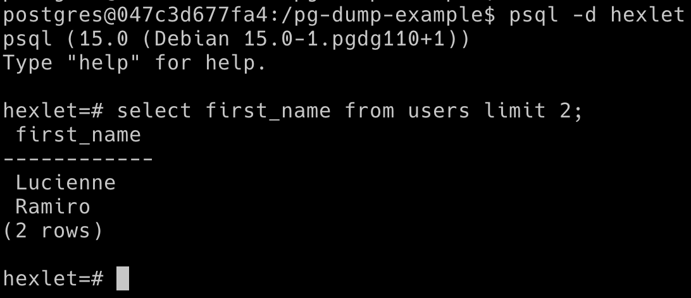

# Установка PostgreSQL

## Подготовка Windows

Для работы с PostgreSQL в Windows вам нужно [включить подсистему Ubuntu](https://ru.hexlet.io/blog/posts/ubuntu-linux-in-windows).

## Установка

Установка PostgreSQL выполняется через терминал. Инструкция ставит PostgreSQL 18, последнюю стабильную версию. Команды для WSL совпадают с командами для Ubuntu.

### macOS

Homebrew держит каждую версию PostgreSQL в отдельной формуле, поэтому в имени пакета указывается версия.

```bash
brew install postgresql@18

# Формула с версией не кладёт psql и другие утилиты в PATH, это делает link
brew link --force postgresql@18

# Запускает PostgreSQL как службу, после перезагрузки она поднимется сама
brew services start postgresql@18
```

### Ubuntu и WSL

В Ubuntu 26.04 PostgreSQL 18 лежит в стандартном репозитории.

```bash
sudo apt update
sudo apt install postgresql
```

В Ubuntu 24.04 стандартный репозиторий даёт PostgreSQL 16. Версия 18 ставится из официального репозитория проекта PostgreSQL, его подключает скрипт из пакета `postgresql-common`. Версию Ubuntu показывает команда `lsb_release -a`.

```bash
sudo apt update
sudo apt install postgresql-common

# Подключает репозиторий apt.postgresql.org
sudo /usr/share/postgresql-common/pgdg/apt.postgresql.org.sh -y

sudo apt install postgresql-18
```

Сразу после установки PostgreSQL запускается от имени вновь созданного пользователя _postgres_. Пользователь _postgres_ понадобится нам дальше. Также будет создана база данных с именем _postgres_.

## Запуск PostgreSQL на Windows (WSL)

В WSL служба PostgreSQL запускается сама, если в дистрибутиве включён systemd. В Ubuntu из Microsoft Store он включён по умолчанию. В старых установках WSL без systemd PostgreSQL придётся запускать вручную после каждого старта WSL. Управлять службой помогают следующие команды:

```bash
# Проверяет текущее состояние базы данных, то есть показывает запущен ли PostgreSQL или нет
sudo service postgresql status

# Команда служит для запуска PostgreSQL
sudo service postgresql start

# Команда служит для остановки PostgreSQL
sudo service postgresql stop
```

## Проверка правильности установки

Теперь убедимся в том, что установка PostgreSQL прошла правильно. Посмотрим из командной строки, запущен ли PostgreSQL:

```bash
ps aux | grep postgres

# Вывод может быть другим
# Главное, чтобы в нем встречалась строчка с текстом bin/postgres
postgres  5564  0.0  0.2 228700 34236 ?        Ss   12:01   0:00 /usr/lib/postgresql/18/bin/postgres -D /var/lib/postgresql/18/main -c config_file=/etc/postgresql/18/main/postgresql.conf
```

В вашем случае вывод может отличаться, но главное — увидеть ту строчку, в которой отображается запуск самой базы данных. Если база данных запущена, то дальше нужно попробовать к ней подключиться. PostgreSQL поставляется со специальной программой _psql_, которая представляет собой интерактивную оболочку (REPL). Через него можно управлять PostgreSQL и выполнять запросы к базам данных прямо из терминала:



## Подключение PostgreSQL

Если PostgreSQL запустить без аргументов, то она пытается подключиться к локальной базе данных, которая находится на той же машине. При этом программа подключается с именем, которое совпадает с именем текущего пользователя. Делает она это с помощью роли с этим же именем. Если PostgreSQL установили верно, то запуск в Linux, например, Ubuntu, негативно реагирует на отсутствие соответствующей роли:

```bash
psql

psql: error: connection to server on socket "/var/run/postgresql/.s.PGSQL.5432" failed: FATAL:  role "tirion" does not exist
```

Эту проблему можно решить с помощью конструкции `sudo -u postgres psql`, которую используют в терминале при подключении PostgreSQL. Но это не лучшее решение, по таким причинам:

* У пользователя _postgres_ есть максимальные права в СУБД. Если завладеть ими, можно все уничтожить. Поэтому приложения или пользователи никогда не создают базы данных от имени _postgres_ и никогда не работают из-под этого пользователя

* Придется постоянно использовать эту конструкцию `sudo -u postgres` для любых команд, которые связаны с СУБД. Если у вас macOS, часть `sudo -u postgres` использовать не нужно. После установки PostgreSQL автоматически конфигурируется для работы с вашим пользователем

## Создание пользователя в СУБД

Чтобы упростить работу по ходу курса, создадим роль с таким же именем, как и пользователь, из-под которого вы работаете. Выполните следующие действия:

1. Посмотрите имя вашего текущего пользователя:

    ```bash
    whoami

    tirion
    ```

2. Создайте роль с таким же именем внутри PostgreSQL с помощью команды `createuser`. Ее нужно запускать от пользователя `postgres`, иначе она попробует соединиться с СУБД от имени текущего пользователя, которого там нет:

    ```bash
    # Флаг --createdb добавляет нашей роли возможность создавать базы данных
    # По умолчанию этой возможности нет
    sudo -u postgres createuser --createdb tirion

    # Чтобы удалить пользователя, можно воспользоваться командой:
    dropuser tirion
    ```

Теперь у нас есть роль в СУБД. Попробуем с ее помощью соединиться с PostgreSQL:

```bash
psql

psql: error: connection to server on socket "/var/run/postgresql/.s.PGSQL.5432" failed: FATAL:  database "tirion" does not exist
```

Снова ошибка. Теперь `psql` «ругается», что не выбрана база данных. Невозможно соединиться с СУБД, если не указать конкретную базу данных. Ее можно указать самостоятельно — передать один аргумент в `psql`.

Мы уже знаем, что внутри PostgreSQL создана база _postgres_. Попробуем подключиться к ней:

```bash
psql postgres

postgres=>
```

Соединение удалось. Теперь посмотрим список ролей. Для этого подходит команда `\du` (Describe Users), которую нужно выполнить внутри REPL:

```bash
postgres=> \du
                             List of roles
 Role name |                         Attributes
-----------+------------------------------------------------------------
 postgres  | Superuser, Create role, Create DB, Replication, Bypass RLS
 tirion    | Create DB
```

В СУБД создалось две роли: _postgres_ и которую самостоятельно добавили ранее. Теперь создадим базу данных.

## Создание базы данных в СУБД

Для экспериментов нам понадобится база данных и, возможно, даже не одна. Создадим базу с именем _hexlet_. Сделать это можно из командной строки командой `createdb`:

```bash
# Опция --owner позволяет указать владельца создаваемой базы данных
sudo -u postgres createdb --owner=tirion hexlet
# Если запустить эту команду без аргументов,
# то она попытается создать базу данных,
# которая совпадает с именем вашего пользователя в системе
createdb hexlet
```

Имя для базы данных выбирается произвольно и обычно совпадает с названием проекта, для которого она создается. Имена баз уникальны в рамках одной СУБД. Это значит, что повторный вызов `createdb` с тем же именем приведет к ошибке.

После установки PostgreSQL создает несколько служебных баз данных, которые нужны для работы самой СУБД. Посмотрим их список:

```bash
# Посмотреть список баз данных
psql -l

# Неполный вывод
                                List of databases
   Name    |  Owner   | Encoding | Locale Provider |   Collate   |    Ctype    |
-----------+----------+----------+-----------------+-------------+-------------+
 hexlet    | tirion   | UTF8     | libc            | en_US.UTF-8 | en_US.UTF-8 |
 postgres  | postgres | UTF8     | libc            | en_US.UTF-8 | en_US.UTF-8 |
 template0 | postgres | UTF8     | libc            | en_US.UTF-8 | en_US.UTF-8 |
 template1 | postgres | UTF8     | libc            | en_US.UTF-8 | en_US.UTF-8 |
```

Теперь у нас есть роль и база данных для экспериментов. Подключимся к этой базе данных:

```bash
psql hexlet

hexlet=>
```

Созданную базу данных можно удалить командой `dropdb`:

```bash
dropdb hexlet
```

Если удалили, не забудьте ее снова создать, так как она понадобится нам в дальнейшем.

Запускать команду `dropdb` нужно с осторожностью. Удаление базы данных — необратимый процесс, так как базы невозможно восстановить без резервных копий. Чтобы избежать проблем: команда `dropdb` не работает без аргументов — ей всегда нужно передавать имя базы.

Удалить базу данных можно только в том случае, если к ней никто не подключен — за исключением того, кто удаляет. Если есть другие клиенты, например _psql_ или _pgadmin4_, то СУБД предупредит о невозможности выполнить команду.

```bash
dropdb hexlet
dropdb: error: database removal failed: ERROR:  database "hexlet" is being accessed by other users
DETAIL:  There is 1 other session using the database.
```

## Управляющие команды

Внутри `psql` доступны разные **управляющие команды**. Все они построены по одному принципу — перед командой набирается обратный слеш `\`, например:

* Чтобы выйти, надо набрать `\q`
* Чтобы посмотреть полный список команд, надо набрать `\?`

Команда `\?` загружает пейджер, по которому можно перемещаться, используя стандартные комбинации текстового редактора Vim:

```bash
postgres=> \?
Informational
  (options: S = show system objects, + = additional detail)
  \d[S+]                 list tables, views, and sequences
  \d[S+]  NAME           describe table, view, sequence, or index
  \da[S]  [PATTERN]      list aggregates
  \dA[+]  [PATTERN]      list access methods
  \db[+]  [PATTERN]      list tablespaces
  \dc[S+] [PATTERN]      list conversions
  \dC[+]  [PATTERN]      list casts
  \dd[S]  [PATTERN]      show object descriptions not displayed elsewhere
  \dD[S+] [PATTERN]      list domains
  \ddp    [PATTERN]      list default privileges
  \dE[S+] [PATTERN]      list foreign tables
  \det[+] [PATTERN]      list foreign tables
  \des[+] [PATTERN]      list foreign servers
  \deu[+] [PATTERN]      list user mappings
  \dew[+] [PATTERN]      list foreign-data wrappers
  ...
```

## Возможные проблемы

В работе с PostgreSQL вы можете столкнуться с такой проблемой:

```bash
psql

psql: error: connection to server on socket "/var/run/postgresql/.s.PGSQL.5432" failed: No such file or directory
        Is the server running locally and accepting connections on that socket?
```

Этот вывод говорит, что подключение не удалось — нужно выяснять почему. В некоторых случаях такая ошибка возникает, если не запущен сервис _postgresql_. Тогда запустите его командой `sudo service postgresql start`, в macOS командой `brew services start postgresql@18`, и выполните подключение повторно.

Еще вам может встретиться ошибка _psql: command not found_. Она указывает, что вы ввели не существующую команду. Это может пройти по трем причинам:

* В названии команды допущена опечатка
* PostgreSQL установлен неверно
* PostgreSQL не установлен вообще

К сожалению, возможных проблем очень много, особенно с учетом разных операционных систем и их версий. Даже опытный разработчик не всегда может взглянуть на вывод ошибки и сразу выдать решение — ему требуется время на изучение проблемы, эксперименты и поиск ответов в Google.

По этой причине мы не даем исчерпывающее руководство по ошибкам. Если у вас возникнут сложности, вопросы по установке лучше задавать [в нашем Telegram-сообществе](https://t.me/hexletcommunity/12) в каналах Базы данных или Операционные системы.
